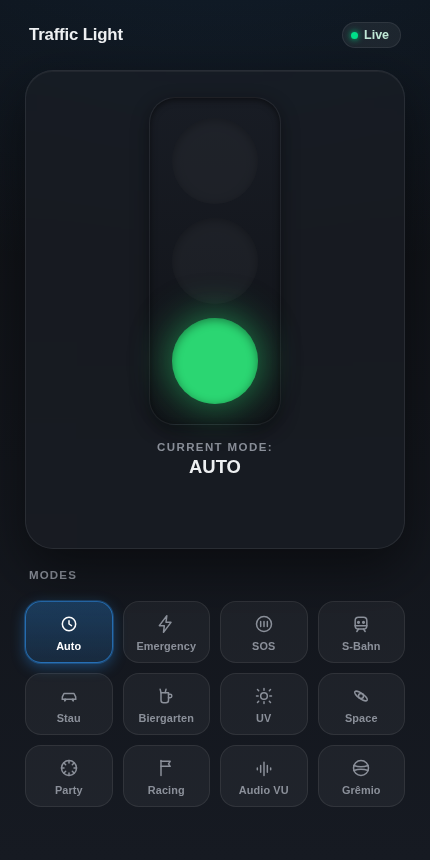
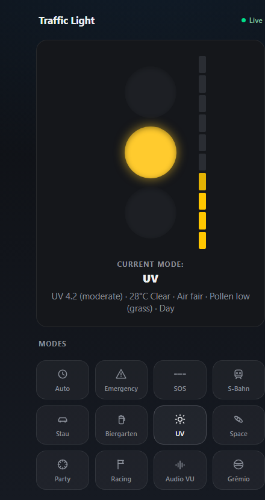
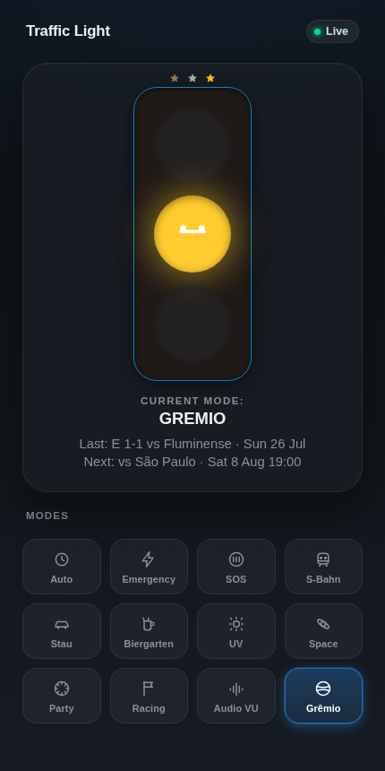

# Traffic Light

A Raspberry Pi wired to three real LEDs, built to answer the one question
that actually matters: is it fine, is it about to not be fine, or is it
already on fire. Trains, UV rays, solar storms, football, your rev
limiter, doesn't matter what's actually wrong, it all boils down to red,
yellow, or green in the end.

<p align="center">
  
  
  
</p>

## What it does

- 12 modes, each an excuse to light up red/yellow/green for a different
  reason, trains, traffic, weather, UV, solar storms, a microphone, your
  football team's feelings, or a sim racing rig. Table below.
- A little segmented bar next to the lights for modes with a real number
  behind them, so you get more than three levels of "eh."
- Grêmio mode gets its own face. Happy, neutral, or furious, depending on
  the last result. This project has its priorities in order.
- Updates push to the browser over Server-Sent Events instead of polling,
  because even a novelty desktop light deserves not to murder your
  phone's battery.
- Plain Python and one static page. No framework, no build step, no npm anywhere near this.
- A SimHub plugin lives in [`simhub-plugin/`](simhub-plugin) so any game
  SimHub reads (iRacing, AC EVO, ACC, LMU, ...) can yell at the lights
  directly, start lights and flags, a live shift-light rev bar, or your
  hotlap delta, over UDP.

## Modes

Eight tiles on the home screen. Weather, Commute, Alerts, Party and Racing hold
sub-modes: tap the tile to start the one you used last, then pick another
from the chips under the light, which also show what each colour means.

| Tile | Sub-mode | Lights up for | Needs |
|---|---|---|---|
| Traffic light | | A normal traffic light cycle |, |
| Clock | | Chimes like an old striking clock: lamps filling up (green, +yellow, +red) or down (red, +yellow, +green) and going dark on the fourth note - 1/2/3/4 sweeps at :15/:30/:45/:00, then one yellow blink per hour. With a speaker, the Westminster Quarters (Big Ben's tune) ring along on synthesised bells, hour bell with each blink. The bar next to the light sets the volume, the button under it mutes. Dark between chimes, quiet 23:00-07:00 | a speaker, for the bells |
| Weather | Temperature | Outside temperature: green 15-26°C, yellow 5-15 or 26-30°C, red beyond |, |
| | Rain | Rain forecast: green dry for 3 h, yellow rain within 3 h, red raining or within the hour |, |
| | UV | Current UV index |, |
| | Biergarten | Temperature / weather / time of day: red before 16:00, below 15°C or with rain, snow or thunder |, |
| | Space | Geomagnetic Kp index (aurora/storm risk) |, |
| Commute | S-Bahn | Minutes to your next train | Deutsche Bahn API keys |
| | Stau | How bad your commute is right now | TomTom or Google Maps key |
| Party | Music | Hops to a random lamp on every beat. Music without a clear beat hops on the loudest hits; silence stays dark | a USB mic |
| | VU meter | Mic level: green, then green + yellow, then all three | a USB mic |
| Racing | Start | Race start lights (red set, yellow ready, green go) and yellow/green flags, via [`simhub-plugin/`](simhub-plugin) | the plugin, UDP → port 9001 |
| | Revs | Shift lights + rev bar | the plugin |
| | Hotlap | Live delta to your best lap: green while faster, yellow while slower, red as soon as the game says the lap is invalid (track limits, penalties) | the plugin |
| Grêmio | | Last match result |, (ESPN) |
| Alerts | Blinking | Blinking yellow |, |
| | SOS | Morse SOS, for when it's actually that bad |, |

Tapping a lamp directly switches to manual: it stays on whatever you tapped.

No API key, no drama, those modes just sit there looking pretty instead
of doing anything useful.

## Hardware

Three LEDs (or a relay board) on the Pi's GPIO, active-low: Red on 22,
Yellow on 27, Green on 17. Change pins/polarity in
`trafficlight/config.py`. No Pi, no wiring, wrong pins, it quietly
switches to fake hardware so the web UI still works and lies to you
gracefully.

## Running the Pi side

```bash
git clone https://github.com/tiagofranzen/pi-traffic-light.git
cd pi-traffic-light
pip install -r requirements.txt   # add --break-system-packages if Raspberry Pi OS is feeling precious
python3 traffic_light.py
```

Open `http://<pi-ip>:8000`. Add it to your phone's home screen if you
want to pretend it's a real app.

Optional environment variables, only needed for the modes that ask for a
key above: `DB_CLIENT_ID` / `DB_CLIENT_SECRET`,
`TOMTOM_API_KEY` (or `GOOGLE_MAPS_API_KEY` as a fallback),
`AUDIO_INPUT_DEVICE`. Where you are lives in the environment too, never
in the code: `WEATHER_LAT` / `WEATHER_LON` (defaults to Munich centre),
`S_BAHN_EVA` (your station's EVA number) and `S_BAHN_SKIP_DESTINATIONS`
(comma-separated end stations of trains going the wrong way), and
`COMMUTE_ORIGIN` / `COMMUTE_DESTINATION` (home and work addresses, for
Stau and the commute).

The Clock bells play through PipeWire, PulseAudio or ALSA, whichever the
Pi has. `CHIME_VOLUME` (0-1, default 0.5) is the starting volume until you
set one in the UI; `CHIME_PLAYER` picks the player yourself, e.g.
`aplay -D plughw:CARD=UC`.

## Where things are

- `traffic_light.py` starts it all.
- `trafficlight/` is the Pi side, one module per tile: `clock.py`,
  `weather.py`, `commute.py`, `party.py`, `racing.py`, `gremio.py`, plus
  `modes.py` (traffic light, blinking, SOS), `controller.py` (the loop that
  runs the active mode), `web.py`, `state.py`, `hardware.py`, `net.py` and
  `config.py`. Each tile's settings sit at the top of its own module.
- `web/` is the page: `index.html`, `style.css`, `app.js`.

## Running the SimHub side

[`simhub-plugin/`](simhub-plugin) is a full SimHub plugin project (.NET
Framework 4.8, C#, Visual Studio). Open
`simhub-plugin/Traffic_Light_Plugin.sln`, build it, restart SimHub,
enable "Traffic Light Plugin (Flags & Revs)" in the plugins list, point
it at your Pi's IP and port `9001`. Works with whatever game SimHub is
reading; pick Start, Revs or Hotlap on the light and go find out how far
past redline you actually are.

## API

- `GET /`, the web UI
- `GET /status`, current state as JSON
- `GET /events`, same state as an SSE stream (what the UI actually uses)
- `GET /?action=set_mode&mode=<name>`, switch mode
- `GET /?action=set_color&color=<red|yellow|green>`, manual override
- `GET /?action=chime&quarter=<1-4>&hour=<1-12>`, ring a Clock chime now to test it (4 = full hour)
- `GET /?action=set_volume&value=<0-100>` or `&mute=toggle`, Clock bell volume (`&preview=1` rings one bell)

## License

MIT, see [LICENSE](LICENSE). Do whatever you want with it, it's a box
that turns on lights.